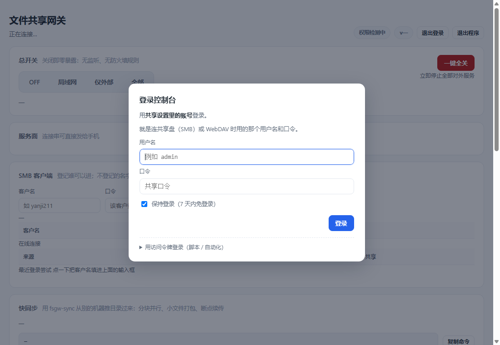
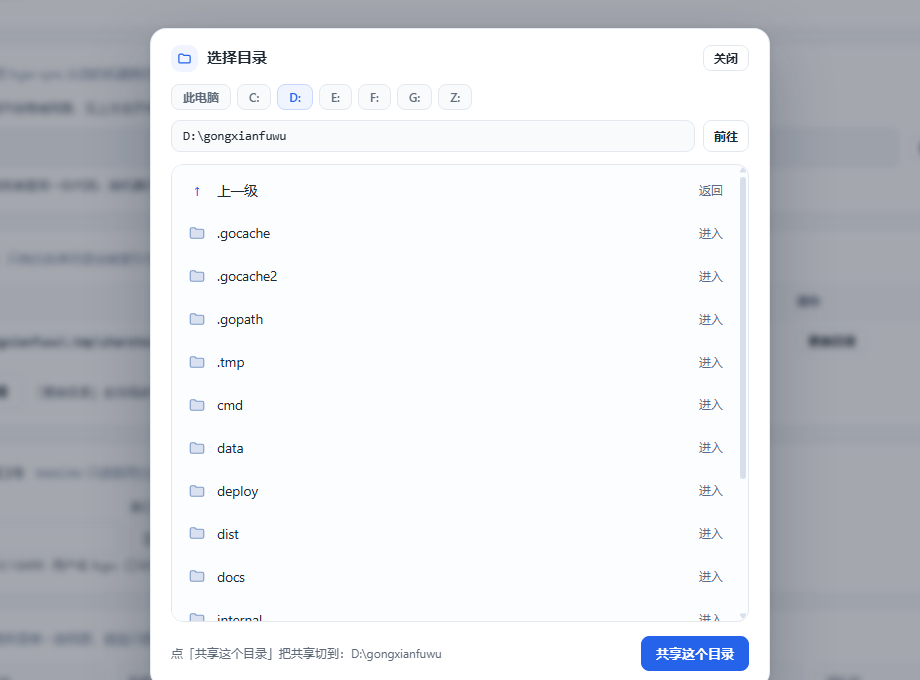

# 熬拜共享家（fsgw）

> **GitHub 公开版说明（2026-11-14）**
>
> 本仓库由内部 SVN 工作副本整理而来，是**可公开发布的版本**，与现场部署的差异：
>
> - 内网地址统一换成 RFC 5737 文档示例地址（`192.0.2.0/24`）；主机名、本机绝对路径、
>   账号名一律泛化。`deploy/linux/110/`、`deploy/windows/88/` 中的编号是**示例主机编号**。
> - 所有 NT 口令哈希与 WebDAV 口令摘要已清空为占位值。`config.yaml`、`smb_clients.yaml`
>   里的账号**必须重新生成哈希才能用于登录**，不要直接拿去连生产环境。
> - 文档与工具里的演示口令统一写作 `changeme`，不代表任何真实口令；辅助工具的默认 IP 也只是示例，
>   使用时请显式传 `-ip` / `-server`。
> - 二进制、运行时数据库（`data/`）、令牌与日志不入库。
>
> 本版本已实测 `go build ./...` 与 `go test ./...` 全绿（Go 1.26）。
>
> **Windows 绿色版（解压即用）**：见 [portable/README.md](portable/README.md)，
> 或从 [Releases](https://github.com/yanji211/aobai-smb-gateway/releases/latest)
> 下载 `aobai-smb-gateway-portable-win-x64.zip`。默认账号 `admin` / `123456`、
> 默认共享目录为解压目录下的 `share\`（**公开默认弱口令，务必在不可信网络中修改**）。
>
> © 2026 成都曼巴科技有限公司 · 保留所有权利

本地常驻网关：局域网直读直写，外部只读走索引，SQLite 为唯一真相源。

- 共享根：`D:\share`
- 目标平台：Windows 10/11 x64 优先落地，Linux 通过平台抽象层复用
- 当前阶段：**三面（SMB / WebDAV / DLNA）全部可运行，45 项自测 + 46 项外部验收全绿**

## 快速开始

```powershell
# 1. 编译（需要 Go 1.23+）
go build -o fsgw.exe .\cmd\fsgw

# 2. 启动：双击 fsgw.exe 就行，或者说命令行敲
.\fsgw.exe
#    等价于 fsgw run -detach -open：
#    弹一次 UAC 自动提权 → 转到后台（不占终端、不留黑框）→ 起来后自动打开控制台

# 3. 想盯着日志、把它按在前台时
.\fsgw.exe run

# 4. 再打开控制台（浏览器里用共享账号的用户名+口令登录）
.\fsgw.exe ui

# 也可以纯命令行操作
.\fsgw.exe status
.\fsgw.exe on -state LAN
.\fsgw.exe off

# 换了二进制但旧进程还占着端口：一条命令换掉
.\fsgw.exe restart
```

启动相关的开关（都可以直接跟在 exe 后面，不用写 `run`）：

| 开关 | 作用 |
| --- | --- |
| `-detach` | 转到后台（脱钩子进程），本进程立刻返回，不占终端 |
| `-elevate` / `-noelevate` | 是否自动申请管理员（默认开；调试/CI 用 `-noelevate`） |
| `-open` | 起来后自动用浏览器打开控制台 |
| `-notray` | 不显示托盘图标（服务方式启动时用） |
| `-config x.yaml` | 指定配置文件 |

已经有一个实例在跑时，再启动**不会起第二个**：会打印「fsgw 已经在运行」并给出控制台地址
（判据是控制台端口能连上且 `/healthz` 正常），所以双击多少次都安全。

### 怎么退出

`fsgw` 常驻（不管是双击跑的，还是 `fsgw run` 前台跑的），下面几条路都能走，
**效果完全一样**（先拆干净再退出）：

| 方式 | 操作 |
| --- | --- |
| 托盘图标 | 右下角通知区域 → 右键图标 → 「退出程序」 |
| 控制台 | 控制台右上角「退出程序」按钮 |
| 命令行 | `.\fsgw.exe stop` |
| 前台窗口 | 在该终端按 `Ctrl+C` |

退出不是简单杀进程：会依次停 WebDAV、停 DLNA（含 SSDP byebye）、
删除 SMB 共享、清掉 `FSGW-` 前缀的防火墙规则，最后把 `state.json` 写回 `OFF`，
再结束进程。所以退出后**没有任何端口和规则残留在系统里**。

只想临时关服务、程序继续跑着，用 `fsgw off`（或托盘「一键全关」）——
这不会退出进程，索引继续维护，随时能再打开。

托盘菜单里还有：左键单击图标＝打开控制台；右键＝当前状态 / 打开控制台 / 一键全关 / 退出程序。
图标悬停提示会跟着状态变（全部关闭 / 局域网开放 / 仅外部开放 / 全部开放）。
若以服务方式或无人登录的会话运行，拿不到通知区域，程序会自动降级为无托盘继续跑；
也可以用 `fsgw run -notray` 显式关掉。

### 提权：默认自动申请，不用手动「以管理员身份运行」

建 SMB 共享要走 `net share`，改防火墙要走 `netsh`，两者都需要管理员权限。
以前得自己右键「以管理员身份运行」，现在**启动时自己弹一次 UAC**：

```powershell
.\fsgw.exe            # 弹 UAC → 提权 → 后台运行
.\fsgw.exe -noelevate # 不要提权（调试、CI、或只用 DLNA/WebDAV 时）
```

几个约定：

- 只在 Windows 上这么做；Linux 上还是 `sudo ./fsgw`，程序只在日志里提示没 root。
- 提权后控制台窗口是**隐藏**的，不会留一个常亮的黑框在桌面上——要看日志去
  `data/logs/fsgw.log`，要停就用托盘菜单或 `fsgw stop`。
- 在 UAC 弹窗里点「否」会明确报错并保留窗口等你按回车，不会一闪就没了。
- 已经是管理员启动的（比如从管理员终端里跑）不会再弹第二次。

未提权（`-noelevate`）时请求 `LAN`/`ALL` **不会整体回退**：SMB 一项降级为警告
（控制台显示「需管理员权限，共享未创建」），DLNA 照常起来、电视照样能发现。
不用网络邻居、只用电视或 WebDAV 的话，完全不需要管理员。
只用外部只读面（`WAN`）也不需要。

### SMB 免密登录（电视/手机不用输用户名密码）

默认是 `smb.auth: account`——必须用本机账户口令登录。要让电视、手机、另一台电脑
直接打开共享不弹密码框，把它改成 `guest`：

```yaml
smb:
  enabled: true
  auth: guest              # 免密（来宾）模式
  guest_writable: false    # 默认只读：电视只该播放，不该能删文件
```

改完用管理员身份启动（SMB 和免密策略都需要提权，`-elevate` 会替你弹一次 UAC）：

```powershell
.\fsgw.exe run -elevate
# 然后在控制台或命令行开启局域网面
.\fsgw.exe on -state LAN
# 逐项确认六个开关是否到位
.\fsgw.exe smb check
```

`fsgw smb check` 会逐项打印，正常应该全绿：

```
  [ OK ] Guest 账户      已启用
  [ OK ] 来宾模式        ForceGuest=1，客户端免密直接进
  [ OK ] 共享是否存在    \\share
  [ OK ] 网络登录权限    Guest 可远程登录
  [ OK ] 空密码网络登录  允许空密码账户从网络登录
  [ OK ] 本机作为客户端  允许访问别人的免密共享
```

注意最后一行只在"本机要去连别人"时才有意义；而**「网络登录权限」这一项必须用管理员窗口运行才读得到**，
非管理员会显示"读不到（非管理员无法读取 LSA 权限）"，那不代表没问题。

六项缺一不可，缺哪项现象都一样（"打不开共享"），所以别只改一项就以为是别的问题：

| 开关 | 缺了会怎样 | 报错 |
| --- | --- | --- |
| Guest 账户启用 | 没有可映射的身份 | `NT_STATUS_ACCESS_DENIED` |
| `ForceGuest=1` | 客户端仍被要用户名口令 | 弹密码框 |
| 共享权限含 Everyone | 会话建起来了，在共享层被拒 | `ACCESS_DENIED` |
| NTFS 上 Everyone 有读权限 | 共享放行了，文件系统拦下 | `ACCESS_DENIED` |
| Guest 不在「拒绝从网络访问」 | 登录类型被拒，前三项全开也白搭 | `NT_STATUS_LOGON_TYPE_NOT_GRANTED` |
| `LimitBlankPasswordUse=0` | Guest 没有密码，空密码不许网络登录 | `STATUS_ACCOUNT_RESTRICTION` |

后两项是**安全策略**，既不在共享权限里也不在 NTFS 里，是最容易漏掉、也最难从报错看出来的。
Windows 客户端版默认就把 Guest 放进「拒绝从网络访问这台计算机」，所以"照网上教程改共享权限"常常无效。

**换共享目录不用重新配免密**：控制台改根目录后，程序会自动给新目录补 Everyone 授权，
并把旧目录的授权撤掉。Windows 上这一步要把 ACE 传播到整棵子树，目录里文件多时
（几十万个文件）会跑几分钟——它**不挡开关切换**，只在后台做，控制台 SMB 卡片会显示
「正在设置免密目录权限」。这段时间用 guest 访问会被拒（`NT_STATUS_ACCESS_DENIED`），
等提示消失再试，不用重启。如果上次进程在传播途中被强杀，下次启动会自动补做一遍。

> 老版本没有这一步，换个目录就出现「guest 能登录、列目录全是拒绝访问」——
> 因为 Guest 会话建起来了，但新目录的 NTFS 上没有 Everyone 这条 ACE。

**电视/播放器上怎么填**：用户名随便填（`guest`、`Guest`、甚至别的）都能进——来宾模式会把任何身份映射成 Guest；
密码**留空**。如果你的客户端是 Linux 内核 cifs 挂载，`-o guest` 走的是"纯匿名会话"，
Windows 会拒（这不是服务端问题），改成 `-o username=Guest,password=` 就好。

**两个必须知道的代价**：

1. `ForceGuest` 是**整机**设置。开启期间，本机所有本地账户的网络登录都会被映射为 Guest，
   也就是说 `guest` 和 `account` 无法并存（配置写 `both` 也按 `guest` 处理）。
   网关关闭时会自动还原成开启前的样子（含上面两条安全策略），备份在 `data/smb_guest_backup.json`。
   如果还原失败，备份会保留并在下次启动时重试——不会出现"关掉了但策略还开着"却没人管的情况。
2. 免密默认**只读**。来宾模式下连管理员经 SMB 也会被映射为 Guest，
   要写入必须把 `guest_writable` 改成 `true`——这等于同一局域网任何人都能改你的文件。

另外，如果你从**另一台 Windows 电脑**去连，可能报"组织的安全策略阻止未经身份验证的来宾访问"。
那是**客户端**的默认策略（Windows 10 1903+），不是服务端问题：

```powershell
.\fsgw.exe smb client-guest on     # 允许本机访问别人的免密共享
```

注意这条只对 Windows 10 及更早版本有效：**Win11 24H2+ 上放开它也没用**（强制签名与来宾会话
互斥），必须在服务端配账号。见「[Windows 11 24H2 / 25H2 客户端怎么连](#windows-11-24h2--25h2-客户端怎么连)」。

### DLNA

电视/手机在同一局域网内应能自动发现「家庭共享」。若搜不到，先在控制台看 DLNA 卡片的提示：

| 提示 | 含义 |
| --- | --- |
| 已广播，电视可自动发现 | SSDP 正常，设备可被发现 |
| HTTP 就绪，但 SSDP 未启动 | 服务能直连，但设备搜不到——通常是组播被防火墙或网络策略拦了 |
| 需开启局域网面 | 当前是 OFF 或只开了 WAN |

也可以直接验证：浏览器打开 `http://<局域网IP>:8200/rootDesc.xml`，能看到设备描述就说明 HTTP 面正常。

**装过 Hyper-V / VMware / WSL 的 Windows 机器**要注意：这类虚拟交换机会多出一块
`172.x` 的网卡，而且常排在物理网卡前面。老版本按"第一个私网地址"挑，就会把这个
只有本机够得着的地址宣告给电视，电视去拉 `http://172.31.208.1:8200/rootDesc.xml`
必然超时——现象是"DLNA 显示已广播，电视里就是没有"。现在改成先按路由表找出
默认出口地址，并跳过虚拟网卡；SSDP 应答和 NOTIFY 也改成**每块网卡各报自己的地址**，
所以多网卡机器上不会再把 A 网段的地址发给 B 网段。控制台 DLNA 卡片上的 IP
就是它当前认定可对外用的地址，和你实际在用的网段不一致时，先看那张网卡有没有默认路由。

DLNA 只暴露媒体扩展名（视频/音频/图片），文档类文件既不出现在 Browse 结果里，
也无法通过 `/media/` 直链取到；两个入口都做了穿越防护。

**同一局域网里跑了两台 fsgw（比如一台 Windows 一台 Linux）**，电视里只会出现一台，
另一台怎么刷新都看不到。原因不是网络，是**设备 UUID 撞了**：UDN 是 SSDP 的去重键，
客户端按它判断"这是不是同一台设备"。早先 UDN = `md5(名称 + 端口)`，而两边默认都是
`家庭共享:8200`，于是两台机器宣告同一个 UUID，电视按 UUID 去重只留一个
（先应答/先缓存的那个，通常就是 Linux 那台），`rootDesc.xml` 两边还一模一样，
从协议角度看它们就是同一台设备。现在 UDN 改成**落盘的随机值**
（`<data_dir>/dlna_udn.txt`，第一次生成后一直复用），同机重启不变、异机绝不相同。

想区分两台设备的名字，改各自的 `dlna.friendly_name` 即可。

### 外部访问口令

浏览器打开 `http://127.0.0.1:8443/share/` 会弹 Basic 认证框，用户名 `admin`，
口令在控制台「外部访问口令」卡片里改，保存后立即生效（服务端会重启一次监听）。
配置文件里只落 `password_hash`，明文不落盘。

### 控制台（Linux 上怎么打开）

控制台默认绑 `127.0.0.1:8444`。Windows 桌面版没问题（托盘菜单或 `fsgw ui` 直接拉浏览器），
但 **Linux 服务器没有桌面，只绑回环等于没有界面**。要让别的机器能打开，配置加三行：

```yaml
ui:
  bind: 0.0.0.0:8444
  allow_remote: true            # 显式确认"允许局域网访问"
  allowed_hosts: [fsgw.lan]     # 走域名访问时填；只按 IP 访问可以不填
```

然后在服务器上取一个能直接点开的地址（`0.0.0.0` 会被换成真实网卡 IP）：

```bash
fsgw ui
# 控制台: http://192.0.2.11:8444/
```

把这个地址复制到能连到该机器的浏览器里，用**共享设置里的账号**登录即可（见下一节）。
放开监听**不等于**裸奔，四道防线照旧：

| 防线 | 规则 |
| --- | --- |
| Host | 只接受回环、本机各网卡 IP、`ui.allowed_hosts` 里的名字；别的一律 403（防 DNS rebinding） |
| 登录 | 人工用「用户名 + 口令」（共享账号）换会话 cookie；脚本用 `X-FSGW-Token`。两者都没有 → 401 |
| Origin | 非空时必须同源，否则 403 |
| CORS | 不回任何 CORS 头，跨源预检拿不到放行 |

`/` 是静态页、不要凭据，所以能打开页面但看不到任何数据——页面会弹登录框。



### 登录：用户名 + 口令（就是共享里那套账号）

不用去服务器上 `cat` 任何文件，输入平时连共享盘用的账号口令就行。校验顺序（命中即通过，
用户名不区分大小写）取的是**共享设置里的账号并集**：

1. `webdav.username` / `password_hash` —— 外部只读面主账号；
2. `webdav.users[]` —— 多账号表；
3. `smb.account_name` + `password` / `nt_hash` —— Win11 连共享盘用的那个账号；
4. `smb_clients.yaml` —— 控制台「SMB 客户端」里登记过的账号。

110 上这三处都是 `admin / changeme`，记一套即可。登录成功后服务端发一个 `HttpOnly` 会话 cookie
（`fsgw_sess`，`SameSite=Strict`，JS 读不到），勾「保持登录」有效期 7 天，**服务重启也不掉线**
（会话落盘在 `<data_dir>/ui-sessions.json`，0600）。右上角「退出登录」清会话并回到登录框。

同一来源连续输错 5 次锁 60 秒，避免有人对着页面磨口令。

### 令牌：只给脚本用

`fsgw ui`、命令行脚本、外部工具仍然走 token，行为与以前完全一致：

```bash
sudo cat /var/lib/fsgw/control.token      # Linux
type D:\fsgw\data\control.token   # Windows
sudo fsgw ui                              # 或者直接要一个带 token 的完整地址
```

登录框底部有「用访问令牌登录（脚本 / 自动化）」折叠区，粘进去也行。
token 只以 `X-FSGW-Token` 请求头发出（SSE 用 `?token=`），不进访问日志；页面从地址栏
`#token` 读到后会立刻把它抹掉。

另外，**重启后控制台先起来**，SMB/WebDAV/DLNA 要等索引对齐完才开放：几十万文件的盘
（比如共享里带 `node_modules`/`.svn/pristine`）大约 2–3 分钟，日志每 5000 条打一行
「索引对齐进行中」，控制台也能看到 `listeners` 还是未就绪。这样重启期间至少能看得见发生了什么。

### 更换共享目录（不用改配置文件）

控制台「共享目录」表每行末尾有「更换目录」。点开是一个目录浏览器，进到目标目录后点
「共享这个目录」即可，当前选中的路径会实时显示。

浏览器里有三种走法，不用一层层退回去：

- 顶部**盘符快捷条**（「此电脑」+ `C:` `D:` …）直接跳盘；
- 路径框**手输完整路径**回车（`D:\照片`，大小写和正反斜杠都认，会自动规范化成全大写盘符）；
- 列表第一行**「上一级」**逐层往上（`D:\share` → `D:\` → 此电脑）。

点确认后当场完成三件事：

1. 校验目录 —— 必须存在、必须是本机绝对路径、不能是 `\\主机\共享` 这种网络路径；
2. **原子写回** `config.yaml` 的 `root`（行内替换，原有注释与其它字段保持不变；写盘失败整体回滚，不会出现"界面上换了、重启又变回去"）；
3. 清掉这个共享的**旧索引**（文件表、版本链、路径历史一起清），后台按新目录重建，表格里显示「重建索引中」，跑完自动消失。

共享地址 `\\主机\share` 不变，只是背后的内容换成新目录。SMB / DLNA / WebDAV / 快同步
如果正开着，会自动跟着换根（几百毫秒）；索引重建（大目录可能要几分钟）在后台跑，
不影响控制台操作。



脚本里也可以直接调接口：

```bash
# token 在 <data_dir>/control.token：Windows 是 D:\fsgw\data，Linux 是 /var/lib/fsgw
T=$(cat D:/fsgw/data/control.token)
curl -X PUT -H "X-FSGW-Token: $T" -H "Content-Type: application/json" \
     -d '{"root":"D:\\新目录"}' \
     http://127.0.0.1:8444/api/shares/main/root
```

返回 `{"result":"ok","root":"<新目录>","rebuilding":true}`；目录不存在/不是绝对路径/是网络路径
会返回 400 并说明原因。

### 改 DLNA 设备名（电视里显示的那一行）

控制台「服务面」里 DLNA 卡片上直接显示当前设备名，右边有「改名」。改完会写回
`config.yaml` 的 `dlna.friendly_name`（只替换这一行，注释原样保留），并让 DLNA 面
重启一轮广播——先 `byebye` 再 `alive`，电视里几秒就跟着变。设备 UUID 不变，
所以在电视看来还是同一台设备，只是换了名字。

同一局域网里有两台 fsgw（比如一台 Windows 一台 Linux）时，两条都叫「家庭共享」很难分辨，
用这个改成「书房」「客厅」即可。接口：

```bash
curl -X PUT -H "X-FSGW-Token: $T" -H "Content-Type: application/json" \
     -d '{"name":"书房 共享"}' http://127.0.0.1:8444/api/dlna/name
```

名字不能为空、最长 32 个字符，否则返回 400。

## 快同步：大文件不断、小文件不磨、多连接吃满带宽

SMB 复制有两个绕不过去的物理事实：**一条会话里请求是串行的**（客户端开多线程只是在排队），
**断了没有"已传偏移"**（只能从头再来）。所以另开一条协议专做批量搬运：

```powershell
# 服务端（和 fsgw 同一个进程，默认 :8445，属于局域网面）
fsgw synctoken        # 打印地址 + token + 一条可复制的客户端命令

# 客户端（Windows / Linux 同一份代码）
fsgw-sync -server http://192.0.2.11:8445 -token <token> `
          -src D:\照片 -dst 相册/2026 -workers 8
```

它做的三件事，正好对上三个痛点：

| 痛点 | 做法 |
| --- | --- |
| 大文件传到一半断，从头再来 | 4 MiB 分块 + 盘上位图；重跑只补缺的块。落盘先写 `<root>/.fsgw-sync/<sid>/*.part`，`fsync` 后才 `rename` 到最终路径——目标文件只有"旧的完整版"或"新的完整版" |
| 单文件再大也只有一条连接的速度 | 每个块是独立 HTTP 请求，同一文件可被 8 条连接同时写不同偏移（实测 160 MiB 单文件 64 MiB/s，同机 SMB 复制是 2.5–5 MiB/s） |
| 几千个小文件磨几分钟 | 小于 `-bundle-kb` 的文件打包成一次请求（一帧一个文件），500 个文件＝1 次往返 |

正确性不是"跑完就算"：

- 每块带 sha256，服务端逐块验；
- 文件收尾校验大小，`sync.verify: full` 时再整文件 hash；
- 整次结束时对每个"已完成"文件 stat 一遍，缺失/大小不符直接翻成失败（这条兜底抓到过"报告成功、磁盘却没有"的文件）；
- 客户端核对服务端返回的 `written/frames`，HTTP 200 不等于"都写了"。

实网实测（Win11 无线 120 Mbps → 192.0.2.11，603 个文件 / 120.6 MiB）：
首次 20.4 s（5.9 MiB/s），再跑一次 0.32 s 全部跳过，`-watch 5s` 下改 2 个文件 240 ms 内补齐；
落盘文件数、总字节、大文件 sha256 全部一致。空口是瓶颈，换千兆有线才能看到协议上限。

常用参数：

```powershell
fsgw-sync ... -dry-run            # 只看会传什么，不传
fsgw-sync ... -checksum           # 按内容比对（慢，但时间戳被改过也不会漏）
fsgw-sync ... -exclude "node_modules|\.venv"   # 正则排除
fsgw-sync ... -watch 30s          # 常驻：每 30 秒扫一次，持续保持同步
fsgw-sync ... -workers 16 -chunk-mb 8          # 2.5G/10G 网络
```

配置（`config.yaml`）：

```yaml
sync:
  enabled: true
  bind: 0.0.0.0:8445
  allow_remote: true        # 绑非回环必须显式点头，和 ui 一样
  roots: []                 # 空 = 所有 writable 的共享根
  chunk_mb: 4
  max_files: 1000000         # 单次会话清单上限（带 node_modules 的目录很容易过十万）
  max_parallel_files: 16
  session_ttl_hours: 72     # 超期会话与它的 .part 自动清理
  verify: chunk             # chunk | full
```

协议、帧格式、断点续传细节、安全边界、实测数据与排错表：[docs/07](docs/07-快同步协议.md)。

> 已知限制：只做单向 push，不删除目标多余文件、不做双向合并；不保留符号链接与 ACL。

## Windows 版：自研服务端接管 445

Windows 版早期是"托管系统共享"（`net share` + `ForceGuest` 整机来宾模式）。
在 Win11 24H2/25H2 上这条路有两个绕不过去的问题：

1. **强制签名**：24H2 起 SMB 客户端默认要求签名。来宾会话没有会话密钥，
   签不了名，免密共享必然被拒（"组织的安全策略阻止未经身份验证的来宾访问"）。
2. **免密只能靠整机开关**：`ForceGuest=1` 是全局的，一开，本机所有网络登录
   都被映射成 Guest——为了一个共享把整台机器的网络身份废掉。

现在 Windows 默认改成**与 Linux 同一套的进程内 Go SMB2/3 服务端**：认证在进程里做，
签名密钥由 NT 哈希派生，免密与账号可以并存，Win11 24H2 也能正常签名登录。

```yaml
smb:
  engine: auto      # auto（默认）| go | native
```

| engine | 行为 | 代价 |
| --- | --- | --- |
| `auto` | 先起自研服务端，起不来（例如 445 让不出来）自动退回系统共享 | 无额外配置，失败会留日志 |
| `go` | 只用自研服务端 | 需要接管 445（见下） |
| `native` | 只用系统共享（`net share`） | 免密在 Win11 24H2 客户端上不可用 |

### 445 是抢过来的，不是共存的

Windows 的 445 由系统服务 `LanmanServer`（显示名 "Server"）在开机时绑死，用户进程
再 bind 只会拿到 `WSAEADDRINUSE`。所以 `auto`/`go` 启动时会做一次**可还原的接管**：

1. 把服务的启动类型与运行状态记到 `<data_dir>\lanserver_backup.json`；
2. 启动类型改手动（防止重启后又被抢走）→ 停服务 → 轮询等 445 真的释放（服务停止最多等 20 秒 + 端口宽限 6 秒）；
3. 端口释放失败就立刻还原并把错误报出来，绝不停在一个"系统共享停了、我们的还没起来"的状态；
4. 网关关闭 / 切到 `engine: native` / 进程被强杀后下次启动，都按备份还原
   启动类型，原来在跑就重新拉起。

**接管期间本机原有的系统共享（`C$`、`D$`、`IPC$` 以及自己 `net share` 建的）不可用**——
445 只有一个。这是"用自研服务端替换系统服务端"的必然结果。要它们共存就选 `engine: native`。

### 有些机器 445 永远让不出来

实测（2026-11-06，本机 Win11）：`LanmanServer` 确实停掉了（事件 7040 有记录、宿主进程重建时间对得上），
但 445 仍被 **PID 4（System，`srv2` 内核驱动）**占着，等 6 秒也不释放。这类机器上自研服务端
**不可能**接管 445。程序的处理是：

- 宽限期到了还拿不到 → 立刻还原系统服务（原来在跑就重新拉起），并把**占用者**写进日志：
  `停止 LanmanServer 后 445 仍被占用（占用者：PID 4（System），等了 6.4s）`；
- 把"本次开机抢不到"记到 `<data_dir>\port445_blocked.json`。同一开机内后续切换**不再去停系统共享**，
  切换耗时从 8 秒降到 1 秒，也不会顺带踢掉别人正在用的连接；
- `auto` 下自动**改用系统共享引擎**（本进程内把引擎切成 `native`），免密改走系统来宾模式
  （`Guest` 启用 + `ForceGuest=1` + `Everyone` 授权），状态栏显示
  `已就绪 · 免密可读写`，地址后面标 `（系统共享）`；
- 免密万一也失败，只降级成"需账户口令"，**不会**再把整个 SMB 面标成"创建失败"。

这台机器上的实测（从 192.0.2.11 用 `smbclient -N` 匿名访问）：

```
srv:~$ timeout 3 bash -c '</dev/tcp/192.0.2.10/445' && echo OPEN
OPEN
srv:~$ smbclient //192.0.2.10/share -N -c 'ls'
  video_0101_...mp4      A 134217728
srv:~$ smbclient //192.0.2.10/share -N -c 'put /tmp/f.txt t.txt'   # 免密写入 OK
```

切回 OFF 后复验：共享删除、`ForceGuest` 还原成 0、`Guest` 重新禁用、系统默认共享（`C$`…）完好。

### 自检与验收

```powershell
.\fsgw.exe smb check          # 引擎 / 445 是否在听 / 共享根可读 / 账号是否配好
dir \\127.0.0.1\share         # 本机回环验证（任何权限都能跑）
net use Z: \\192.0.2.10\share /user:admin changeme
```

`smb check` 在 `go` 引擎下不再检查 Guest/ForceGuest/LSA 那一套（那些只在 `native` 下有意义），
改为检查真正会挡住 Win11 的三件事：445 在听、共享根可读、账号表非空。

### 本机协议验收（不需要管理员权限）

Windows 自带的重定向器**不支持** `\\主机@端口\共享` 这种带端口的写法，所以没提权（抢不到 445）时
没法用资源管理器验证自研服务端。`tools/smbping` 用第三方纯 Go SMB2 客户端（`hirochachacha/go-smb2`）
当"外部考官"，对着任意端口的服务端做黑盒验收，覆盖：列目录/查属性、建-写-读-改名-删、
大文件流式读写（SHA256 比对）、几百个文件的多目录批量复制、多会话并发。

```powershell
# 窗口 1：把服务端起在 4450（不需要管理员）
.\tools\go.sh build -o .tmp\smbserve.exe .\tools\smbserve
.\.tmp\smbserve.exe -root D:\share -share share -addr :4450 -user admin -pass changeme

# 窗口 2：验收
.\tools\smbping.sh -mb 128 -bulk 300 -dirs 12 -conc 6
.\tools\smbping.sh -addr 127.0.0.1:4451 -user guest -pass ""   # 免密通道
```

退出码 0 = 全通过。这个工具在本机打出的三个真缺陷（改名失败、新建文件夹必报"已存在"、
内层端口写死导致多实例串台）见 `docs/05` 第 9.6 节。

### 怎么回退

把 `smb.engine` 改成 `native` 重启网关即可：接管时的备份会被读出来，服务启动类型还原、
`LanmanServer` 重新拉起。或者直接关掉网关（`fsgw off`），445 立即释放、系统共享自动回来。

## Linux 部署（纯 Go SMB 服务端）

Linux 上不装 samba、不写 `/etc/samba`、不建系统账户：SMB2/3 服务端是进程内的纯 Go 实现
（`github.com/sonroyaalmerol/go-smb-server`），对外 445 由网关自己持有。

```bash
# 交叉编译（开发机在 Windows 上也能出 Linux 二进制）
GOOS=linux GOARCH=amd64 ./tools/go.sh build -o deploy/linux/fsgw ./cmd/fsgw

# 部署：脚本会把二进制、/etc/fsgw/config.yaml、systemd 单元一次装好
cd deploy/linux && sudo sh install.sh

# 开关（部署在 /etc/fsgw 时不必再带 -config，会自己找到）
sudo fsgw on -state ALL
sudo fsgw off                 # 一键全关：445/8200/8443 立刻停止监听
sudo fsgw smb check           # 445 是否在听 / 共享根是否可读 / 匿名能否列目录
```

共享根在 `deploy/linux/config.yaml` 的 `shares[0].root`（当前部署是 `/srv/share`），
共享名是 `shares[0].name`（`\\<IP>\share`）。

`systemctl restart` 后开关会回到 `state.json` 里记的状态（默认 OFF），需要再 `fsgw on` 一次。

### 为什么要在协议边界上改字节

库本身可用，但它对若干细节的处理与 Windows 客户端、samba 的期望不一致，而这些都是
"状态码正常、客户端报错"的类型，只能逐条对着 samba 的抓包结果改。`internal/smbgo/proxy.go`
就是这层翻译，按问题出现的顺序：

| 现象 | 原因 | 处理 |
| --- | --- | --- |
| `net use` 报系统错误 121（超时） | 客户端首包是 SMB1 协商，纯 SMB2 服务端不回 | 合成等价的 SMB2 协商请求转给内层 |
| 报系统错误 53（找不到网络路径） | 协商响应没带 SPNEGO，Windows 走裸 NTLM 与库的 SPNEGO CHALLENGE 对不上 | 补 `NegTokenInit` |
| 同上，且会话起来后要求签名 | 库没有"来宾"概念，`SessionFlags` 恒为 0 | 置 `SMB2_SESSION_FLAG_IS_GUEST` |
| 同上，且 10 秒后 RST | 库把 `IPC$` 也按磁盘共享回，DFS 探测流程走不下去 | 改成 `ShareType=PIPE` + `MaximalAccess=0x001F00A9` |
| 同上 | 库对 `FSCTL_DFS_GET_REFERRALS` 回 `STATUS_INVALID_HANDLE`（句柄级致命错误） | 改回 samba 的 `STATUS_NOT_FOUND` |
| 列目录报错误 58（无法运行请求的操作） | 最简 `QUERY_INFO` 是 104 字节，库要求 105 字节 | 补 1 字节填充 |
| 卡死 20 秒 | 客户端每个请求要 33 个 credit，库只批 1 个 | 补足 credit |
| 同上 | 客户端要 `FileBothDirectoryInformation`(0x03)，库按 0x01 布局回 | 按目标信息类重排目录项 |
| 只列出 1 条 | 库对同一句柄只枚举一次，第二次直接 `NO_MORE_FILES` | 请求侧强制 `RESTART_SCANS` + 放大缓冲区，响应侧按句柄游标切页 |
| 剩余空间显示 0 / 显示恒为 1TB | 库没实现 `0x07`，`0x03` 的 `BytesPerSector` 写错偏移 | 用 `statfs` 回真实容量 |
| Win11 24H2+ 收到挑战后不发 `AUTHENTICATE`，2ms 内连发 9 次 `SESSION_SETUP`，最后 `net use` 报错误 67 | 挑战里的 NTLM flags 少了 `EXT_SESS_SEC`/`SIGN`/`ALWAYS_SIGN`。24H2 起默认强制 SMB 签名，签名的会话密钥要靠扩展会话安全派生；缺了这些位，客户端既算不出可签名的密钥，也不肯退回弱会话安全 | 补齐三个能力位（`serverSupportedFlags`） |
| 卷标/卷容量那两行导致 `dir` 报错误 58（资源管理器与 PowerShell 却正常） | 卷信息两个结构都畸形：`FILE_FS_VOLUME_INFORMATION` 把卷标写在偏移 16（规范是 18，中间有 `SupportsObjects` + 保留字节）；`FILE_FS_ATTRIBUTE_INFORMATION` 被按客户端 18 字节缓冲截断，`FileSystemNameLength=8` 却只剩 6 字节 | 两类卷信息都在代理层按规范整体重建，不再按缓冲截断 |

自查办法是让同一台 Windows 客户端先去连一遍 samba，抓下"成功"的字节流，再逐包对照——
上面每一条都是这么定下来的，不是猜的。

### Windows 11 24H2 / 25H2 客户端怎么连

**免密在 Win11 24H2+ 上不可能成功**，这不是配置问题：24H2 起 SMB 签名默认强制，而来宾会话
没有会话密钥、签不了名。微软文档写得很直白——就算放开 `AllowInsecureGuestAuth`，签名也会把它挡掉。

所以服务端维护一张**客户端账号表**：表里的名字必须对口令，表外的具体用户名一律拒绝，
匿名类名字（空 / `guest` / `anonymous` …）仍按来宾放行，电视和手机照旧。

为什么表外要拒绝而不是悄悄放行：放行得到的是一个"来宾会话"，Win11 24H2 会否决它，
上层只看到 `0x80004005` 或"策略阻止未经验证的来宾访问"；明确拒绝反而让资源管理器
正常弹出"输入网络凭据"，填上登记过的账号就能进。

#### 在控制台里加账号

```bash
# 控制台只绑回环，从 Windows 上用端口转发进去
ssh -L 8444:127.0.0.1:8444 example-user@192.0.2.11
# token 在启动日志里
journalctl -u fsgw | grep -o 'http://127.0.0.1:8444/#[0-9a-f]*' | tail -1
```

浏览器打开那个带 token 的地址，在**「SMB 客户端」**一栏：

- 「客户名 / 口令 / 备注」→ 添加 / 更新，立刻生效（445 按新表重启，已有连接不受影响）；
- 下方「在线连接」实时显示谁连着、用哪个账号、访问了哪个共享；
- 「最近登录尝试」列出谁来敲过门、结果是通过 / 来宾 / 被拒——点一下就把那个客户名
  填进上面的输入框，不用手抄（**某台设备连不上时先看这里**，被拒的名字照抄即可）。

账号表存在 `/etc/fsgw/smb_clients.yaml`（与 config.yaml 同目录，权限 0600），
只有 NT 哈希、没有明文，可以手工编辑，改完重启 fsgw 生效。

#### 在配置文件里加账号

```yaml
smb:
  auth: guest                 # 仍保留匿名来宾：电视/手机/老系统照旧能进
  account_name: admin         # 兼容写法，等价于账号表里的一条
  nt_hash: "00000000000000000000000000000000"   # 占位示例：请用 fsgw smb nt-hash <口令> 生成后替换
  # 也可写明文：password: "changeme"（哈希优先）
```

`fsgw smb nt-hash <口令>` 生成哈希（NT 哈希 = MD4(UTF-16LE(口令))，NTLM 验算只需要它）。

`fsgw smb check` 会报当前登记了几个账号、账号表在哪个文件。

#### 多账号

SMB 侧天然支持多账号：`config.yaml` 的 `account_name` 算一条，`smb_clients.yaml` 里的每条再各算一条，**取并集**。
两个来源同名时以账号表为准（方便在面板里改口令）。

```yaml
# /etc/fsgw/smb_clients.yaml —— 每台机器发一个账号，别共用
clients:
    - name: admin
      nt_hash: 00000000000000000000000000000000   # 示例口令
      note: 通用账号
    - name: fsgw
      nt_hash: 00000000000000000000000000000000   # 示例口令
      note: 老账号，电视/笔记本用
```

WebDAV 侧原本只认单账号（`username` + `password_hash`），现已支持 `users:` 列表，与单账号写法**取并集**：

```yaml
webdav:
  username: admin
  password_hash: "sha256$...$..."     # 示例口令
  users:
    - username: fsgw
      password_hash: "sha256$...$..."  # 示例口令
    # 再加人就照这两行往下写
```

摘要用 `fsgw passwd -password <口令>` 生成，**别手抄旧值**。

> **坑：NT 哈希必须是 32 个十六进制字符。** 少一位时 `smb-clients` 解析会静默跳过这条账号，
> 表现是 `fsgw smb check` 里能看到它、但登录时报"未登记的客户端账号"。这个仓库原来的示例值
> 就少了 `EA` 两位（`000000000000000000000000000000`），照抄会踩。

#### Win11 上这样连

```cmd
net use Z: \\192.0.2.11\share <口令> /user:<客户名> /persistent:no
dir Z:\
```

如果这台 Windows 的登录用户名已经在账号表里、口令也对，**连 `/user:` 都不用写**——
`net use \\192.0.2.11\share` 会拿当前登录身份直接通过，资源管理器双击也一样。

> 连不上时不要临场发挥，走 [`docs/06-Win11连不上共享盘-修复手册.md`](docs/06-Win11连不上共享盘-修复手册.md)：
> 里面按症状分流（445 不通 / 来宾被拦 / 开机后盘符不可用 / 只读），每步都给了可复制的命令和验收标准，
> 也可以直接交给那台机器上的 agent 执行。

之前记录过的"同一条 TCP 连接上第二个会话必失败（错误 67）"，根因是服务端只认 SPNEGO
封装、而对裸 NTLMSSP 也回了 SPNEGO 挑战：Windows 在复用连接上重建会话时发的是裸包，
收到 SPNEGO 就解析失败、几毫秒内连开几个会话后放弃。现在按请求的形状回敬，这个边界不存在了。

### Linux / macOS 客户端怎么连

**问题不在认证**。过去 Windows 10/11 一切正常、而 `mount -t cifs` 报
`mount error(9)`/`error(20)`、macOS 干脆连不上，根因是三个协议细节，而且互相掩盖——
修好一个才露出下一个：

| 现象 | 原因 | 处理 |
| --- | --- | --- |
| `mount error(9)……get root inode failed` | 内核打开共享根发的是一条**复合报文** `CREATE + QUERY_INFO + CLOSE`，后两条带 `RELATED_OPERATIONS`、FileId 填保留值 `0xFFFF…FF`（语义是"沿用上一条的句柄"）。内层库没有复合语义，逐条当独立请求解析 → `STATUS_INVALID_HANDLE` | 代理层 `exchangeCompound`：拆成独立请求换手，把保留 FileId 换成上一条 CREATE 的真句柄，再把响应合回一条复合响应 |
| `mount error(20)……Not a directory` | `FILE_ALL_INFORMATION` 只回了 84 字节，内核按 `sizeof(FILE_ALL_INFO)=101` 校验失败（日志里连带 `bogus file nlink value 0`） | `fixFileAllInfo` 按 MS-FSCC 2.4.2 重建到 104 字节，`NumberOfLinks` 兜底为 1 |
| 内核 `Invalid protocol negotiate response size` / smbclient `NT_STATUS_INVALID_NETWORK_RESPONSE` | `FSCTL_VALIDATE_NEGOTIATE_INFO` 的输出长度被客户端钉死为**恰好 24 字节**；协商响应里的 ServerGuid 在 `body[8:24]`，取错只在 smbclient 上显形（内核不校验 GUID） | 输出固定 24 字节；GUID 偏移纠正 |
| 取不到设备信息直接 abort | `FILE_FS_DEVICE_INFORMATION`(0x04) / `FILE_FS_SECTOR_SIZE_INFORMATION`(0x0b) 只有 Linux/macOS 会问，Windows 从不问，内层一律回 `STATUS_INVALID_PARAMETER` | 按 `compat.fsProbe`（非 Windows 才开）补上 |
| mac 报 `mount error: /挂载点: No such file or directory`（RC=64），内核日志 `Server closed their side of the connection` | **mac 把共享名转成大写再发**：`\\host\SHARE`，内层按字面比对 `SHARE ≠ share` → `STATUS_BAD_NETWORK_NAME`。这个 errno 与本地目录毫无关系，极具误导性；用 `smbutil view` 能确认用户态是通的 | `fixTreePath`：TREE_CONNECT 进内层前把共享名改回真实大小写。只改字符不改长度，偏移与签名都不受影响；对 Windows/Linux 是空操作 |

Windows 把这三步拆成**三条独立请求**发，所以从头到尾不受影响——这也是为什么"照 Windows 的抓包改"永远发现不了这几个坑。

接入端是**两阶段识别**（`internal/smbgo/client.go`）：首包给暂定结论，收到真正的 SMB2 NEGOTIATE 后由 `refineClient` 修正（变化时打「接入端识别已修正」，并同步到控制台）。结果同时用于**「接入端」列展示**与**决定开哪些兼容补丁**：

| 判据（按强度排序） | 判为 |
| --- | --- |
| 只声明 1 个方言、且首包就是 SMB2 协商 | `linux-cifs`（`mount.cifs vers=` 只翻成一条；Linux 内核对从不发 SMB1 探测） |
| 发过 SMB1 探测、**又补发**独立 SMB2 协商，且带 MULTI_CHANNEL | `macos`（Windows 拿完探测包的响应就直接 SESSION_SETUP，从不补发；mac 实测 caps=0x7f） |
| 首包是 SMB1 探测包 | `windows`（**暂定**：mac 也发，两者首包一字不差，等后续帧修正） |
| 带 MULTI_CHANNEL / PERSISTENT_HANDLES 能力位 | `windows`（须在加密位之前判） |
| 声明 3.1.1 且没有加密位 | `macos`（老版本画像；Big Sur 实测带 0x40，这条不能单独用） |
| 带 ENCRYPTION 能力位 | `linux-samba`（smbclient 用户态默认要求加密） |

> mac 与 Windows 的首包**完全一样**（同样的 `"NT LM 0.12" / "SMB 2.002" / "SMB 2.???"`，都不带 NativeOS），
> 单帧指纹分不开，只能看行为序列——详见 [`docs/05`](docs/05-SMB-Go服务端实战总结.md) 第 12 章。

指纹认错（例如套了隧道、出口 IP 不同于真实客户端）时用配置兜底，IP 精确或前缀匹配，**优先于指纹**：

```yaml
smb:
  client_hints:
    - ip: 192.0.2.150
      kind: macos
```

客户端这边照常挂，不需要额外参数：

```bash
# Linux 内核 CIFS：免密
sudo mount -t cifs //192.0.2.11/share /mnt/s -o guest,vers=3.0
# Linux 内核 CIFS：账号
sudo mount -t cifs //192.0.2.11/share /mnt/s -o username=admin,vers=3.0
# smbclient（Samba 用户态）
smbclient //192.0.2.11/share -N -c 'ls'
```

macOS：访达「前往 → 连接服务器」填 `smb://192.0.2.11/share`；终端挂载：

```bash
# 账号
/sbin/mount_smbfs '//admin@192.0.2.11/share' ~/prod
# 来宾（-N 是 mount_smbfs 的选项，`mount -t smbfs` 不认；`-o guest` 也不认）
/sbin/mount_smbfs -N '//guest@192.0.2.11/share' ~/prod
# 卸载：umount 常报 Resource busy，用这个
diskutil unmount force ~/prod
```

mac 上还有两个纯客户端的坑：**挂载点别用 `/tmp`**（Big Sur 上它是 `/private/tmp` 的符号链接，
挂上后 ssh 会话访问会 `Operation not permitted`，是隐私保护拦了网络卷，不是没挂上）；
**首次挂载前 mac 会发 SMB1 探测包**，所以日志里可能先看到 `client=windows` 再看到「接入端识别已修正」到 `macos`，这是正常的。

排查时先开 `FSGW_SMB_TRACE=1` 逐帧看双向命令流（常态日志只记被改写的帧，看不出客户端在哪一步放弃），
再配合 `/proc/fs/cifs/traceSMB` 与环回抓包——`tcpdump -i lo -U -s 0 -w x.pcap port 445` 之后
`python tools/smbdec.py x.pcap`（纯标准库，不需要装 scapy；`smbdec.py x.pcap create` 只看 CREATE 的路径与 FileId）。
三个根因的推导过程、报文布局和踩坑清单见
[`docs/05-SMB-Go服务端实战总结.md`](docs/05-SMB-Go服务端实战总结.md) 第 11 章；
macOS 的共享名大小写与两阶段识别见第 12 章。

已实测通过的操作：挂载、列目录、`df`、写文件、追加、`cp` / `cp -r`、`mv`（文件与目录）、
`mkdir -p`、`rmdir`、`rm`、`rm -rf` 整树、`truncate`、`touch`、`stat`。`ln -s` 不支持——
CIFS 建软链要挂载参数 `mfsymlinks`，与网关无关。
macOS 11.7 上同一组操作（含 `df` 显示真实容量、来宾与账号两种挂载）也已全部实测通过。

> **回归时记住三条**：24 字节的 ioctl 输出、101 字节的 `FILE_ALL_INFO` 都是硬性上下限，生成型改动别多给字节；
> 判"是不是响应"只看 SMB2 头就够，多要 8 字节会漏掉 70 字节的 `SET_INFO` 响应（症状是固定 10 秒卡顿 + `rmdir` 失败）；
> 复合报文里凡是"按请求内容算出来的键"（FileId、目录游标键）都必须在**替换保留值之后**再算。

### Apple 元数据：`.DS_Store` / `._xxx` 怎么处理

mac 访问过的每个目录都会多出东西，这是 macOS 的既定行为，不是网关生成的：

| 名字 | 是什么 | 谁写 |
| --- | --- | --- |
| `.DS_Store` | 该目录的图标位置、窗口大小、排序方式 | Finder 每次浏览/改布局 |
| `._foo.txt` | `foo.txt` 的 AppleDouble：资源分叉 + 扩展属性 | 复制/保存文件时 |
| `.Trashes/` `.TemporaryItems/` | 废纸篓、移到废纸篓的暂存 | 删除文件时 |
| `.Spotlight-V100/` `.fseventsd/` | Spotlight 索引、文件系统事件日志 | 挂载后自动 |
| `.apdisk` `.VolumeIcon.icns` | 网络卷图标与 AirPort 标记 | 挂载后自动 |

网关给的三层处理，按需取用：

**① 列目录过滤（默认已开，不用配）**——Windows / Linux / 电视枚举目录时这些名字直接不出现，
磁盘上的文件照旧保留。mac 自己**仍然看得见**自己的 `.DS_Store`：它找得到就不会每次进目录重建一遍，
Finder 的窗口布局也存得住。这是"按接入端单独处理"的那一半。

```yaml
smb:
  apple_meta: hide    # 默认。只对非 macOS 隐藏
  # apple_meta: all   # 连 mac 一起藏（mac 会因此反复重写 .DS_Store，不推荐）
  # apple_meta: off   # 都不过滤，排障用
```

**② 清存量**——`fsgw clean-meta` 扫全部分享根（默认只列清单，`-force` 才删）：

```bash
sudo fsgw clean-meta -config /etc/fsgw/config.yaml            # 看清单
sudo fsgw clean-meta -config /etc/fsgw/config.yaml -force     # 真删
sudo fsgw clean-meta -config /etc/fsgw/config.yaml -v -force  # 逐条打印
```

只删白名单命中的名字，且只删共享根之内；符号链接不跟随。110 上实测清掉 239 个 `.DS_Store`（500 KB）。

**③ 从源头关掉**——`.DS_Store` 是 Apple 官方可关的，在 mac 上执行一次，重启 Finder 生效：

```bash
defaults write com.apple.desktopservices DSDontWriteNetworkStores -bool true
killall Finder
```

这条只关 `.DS_Store`，管不了 AppleDouble（`._xxx`）——后者由服务端能力决定，
网关不支持 NTFS 扩展属性写入，mac 就会退化成 `._` 文件。所以真正"一个都不产生"做不到，
但"看不见 + 定期清"能全链路闭环。

> 过滤发生在 `fixQueryDirectory` 里、分页游标之前，所以切页与 `STATUS_NO_MORE_FILES`
> 都按过滤后的条数算。500 个文件 + 167 个 `._` 的目录实测：Windows 与 Linux 都看到正好的
> 500 条，无重复、无遗漏。

### 只支持 SMB1 的老设备（小米电视、老投影、老播放器）

有些设备的 SMB 客户端只声明一个方言 `NT LM 0.12`，**完全没有 SMB2**。网关自己的
服务端是纯 SMB2/3 实现，把这类客户端的协商改写成 SMB2 之后，它收到一份看不懂的
响应就静默放弃——现象是"网络邻居里能看到设备、点进去一直转圈"，服务端日志里连
认证都没开始。

做法是**按客户端类型分流 + 进程内置 SMB1 通道**：网关仍独占 445，读出首帧后判定
方言表里没有任何 `SMB 2.xxx`，就把这条 TCP 连接整条（含已读出的首帧）交给
`internal/smbgo/smb1srv.go` 里的最小 SMB1 服务端。

这条通道**两个平台共用同一份代码**：Linux 不用装 samba，Windows 也不用打开系统的
SMB1 功能，老设备都能看到共享。

```yaml
smb:
  smb1_backend: ""   # 留空（默认）= 用内置通道
```

> 想改用外部 samba（比如要它那套多用户/日志），把它填成 `127.0.0.1:4450`，
> 并按 `deploy/linux/smb1.conf` 起一份只监听回环、只讲 NT1 的实例即可；
> 代码路径不变，`relayToSMB1` 会裸转发整条连接。

分流点在 `proxy.go`：`smb1Dialects` 解出方言表 → `smb1Only` 判断 → 内置通道或外部后端。
判定只认"一个 SMB2 方言都没有"，所以 Windows 那种 "NT LM 0.12 + SMB 2.002" 的探测包
不受影响，照旧走 SMB2。

内置通道支持：协商 / 匿名会话 / 建树 / 列目录（含中文名与 `.DS_Store` 过滤）/
读文件 / 容量查询 / 列共享（MS-RAP 与 IPC$ srvsvc 两条路）。它是**只读**的
（文件写入一律 `ACCESS_DENIED`），老设备只看片够用；写入仍走 SMB2/3。
实现细节与踩过的坑见 `docs/05-SMB-Go服务端实战总结.md` 第 14 章。

验证过的链路（2026-11-11）：`smbclient -m NT1` 打 Linux 110 的 445 与 Windows 88 的
内置通道端口，列共享、列目录、进中文子目录、下载中英文名文件全部正常，同时
SMB2 客户端与 mac 均未受影响。

### 可写共享（Linux 版）

Linux 侧的写入不是"改个开关就行"：底层库的写路径有几处硬缺陷，过去一直是靠"共享只读"
绕过去的。要让 `writable: true` 真的能写，下面三处必须一起修（已实现在 `internal/smbgo`）：

```yaml
shares:
  - writable: true          # 共享可写
smb:
  guest_writable: true      # 来宾也放行（Linux 侧整体可写，不分账号）
```

| 现象 | 根因 | 处理 |
| --- | --- | --- |
| 新建的文件总是 0 字节；资源管理器报"目标文件夹访问被拒绝 / 你需要权限来执行此操作"，而覆盖已有文件却正常 | 库的 `getFlags` 对 `FILE_CREATE` 只给 `O_CREATE\|O_EXCL`，没有 `O_RDWR`，句柄是只读的，随后的 `WRITE` 必然 `EBADF` → 被映射成 `ACCESS_DENIED` | `createFixBackend`（`server.go`）：自己按 `O_CREATE\|O_RDWR`（或加 `O_TRUNC`）建/截断，再把 Disposition 改成 `OPEN_IF` 交给库 |
| 大文件复制"进度走完但报意外的网络错误"，或 .NET 的 `FileStream`/`Set-Content` 一个字节都写不进去 | 复制路径建好文件后会先发 `SET_INFO` 的 `FileAllocationInformation`(19) 预占空间，库只认四类 SET_INFO，其余回 `NOT_SUPPORTED`，客户端当致命错误 | 代理层直接答成功（`ackAllocationSetInfo`，`proxy.go`）：这条只是空间预占提示，不影响落盘 |
| 删除静默失效（文件还在）、截断/改时间戳无效、重命名不动 | 库是用**类型断言**找 `vfs.Remover` / `vfs.SetInfoer` / `vfs.Renamer` 的，`normalizeBackend`、`stableHandle` 不实现/不转发这几个接口 | 两层包装各补上转发；`readOnlyBackend` 保持不实现，只读语义不受影响 |
| 重命名后目录里多出一个名字里带反斜杠的畸形条目，紧接着列目录报 `ERROR_BAD_NET_RESP`（错误 58） | 库的 `localHandle.Rename` 用 `filepath.Base(filepath.FromSlash(newPath))`，Linux 上 `FromSlash` 不转反斜杠，`\dir\b.txt` 被当成一个文件名 | `stableHandle.Rename` 先 `normalizePath` 再交给库 |

验收（在 Windows 上）：新建/覆盖/**200MB 复制后 MD5 一致**/读回 MD5 一致/重命名/删除/列举全通；
来宾侧用 `smbclient //<IP>/share -N -c 'put file.txt x.txt'` 也能写。
已知边界：重命名只在同目录内生效（库只取 basename），跨目录移动请用复制 + 删除。

### 大文件/多文件复制几十秒后断连（第三方库已打补丁）

如果复制一批文件、传了几十秒后弹"出现了意外的网络错误"，且服务端日志（`log.level: debug`）里
出现 `transport: unexpected frame type byte 0xfe`，就是这一条：

- **根因**：内层 SMB 服务为了回写异步响应，给连接设了 200 ms 读截止时间，超时后 `continue`
  重读；但读帧用的是 `io.ReadFull`，**中途超时会把已收字节丢掉、读位置停在帧中间**，
  下一轮就把 SMB2 报文里的 `0xfe` 当成帧头 → 断链。客户端一次发 1 MB 的 `WRITE`，
  磁盘忙时读不满 200 ms 就会踩中。
- **修复**：库已 vendor 到 `third_party/go-smb-server` 并打了"可续读"补丁
  （`smb/transport/frame.go` 记录 `hdrRead`/`bodyLen`/`bodyRead`，超时保留进度），
  `go.mod` 里加了 `replace github.com/sonroyaalmerol/go-smb-server => ./third_party/go-smb-server`。
  **构建时必须带上 `third_party/` 目录**，否则会退回上游的有缺陷版本。
- **验收**：600 MB（40×15 MB）一次性复制成功、MD5 全一致；100 MB/200 文件 + 10 个子目录成功；
  服务端 `unexpected frame type` 计数为 0（修复前每分钟数次）。
- 详细的定位过程与抓包证据见 [docs/05](docs/05-SMB-Go服务端实战总结.md) 第 3.5 节。

### Win11 客户端接入：为什么"这台能连、那台连不上"

服务端同时放行"账号"和"来宾"两种登录（`auth: guest` + `account_name` + `clients` 表），
但 **Win11 24H2 起客户端默认强制 SMB 签名**，而来宾会话没有会话密钥、签不了名：
客户端要么弹"你组织的安全策略阻止了未经身份验证的来宾访问"，要么直接 `0x80004005` / 错误 67。

所以能不能连，取决于这台机器**有没有用账号认证上**：

- 该机器的 Windows 登录名恰好等于登记过的账号名、且口令一致 → 隐式 NTLM 直接通过，什么都不用配；
- 否则（绝大多数情况）→ 退到来宾 → 被签名策略拦掉，看起来就是"连不上"。

也就是说，**问题不在服务端，而在每台客户端要显式带上账号**。服务端日志能直接验证：

```bash
journalctl -u fsgw | grep -E '会话已通过|拒绝了未登记'
# 通过： "SMB 会话已通过账号口令认证","user":"example-user","domain":"WIN-FSGW"
# 失败： "SMB 拒绝了未登记的客户端账号","user":"root" → 随后 "SMB 会话按来宾放行"
```

### 一键修复 exe（`tools/smbfix`）

`dist/fsgw-connect.exe`（2.6 MB，单文件、无依赖、不写服务端）双击即用，会自提权后按 9 步走：

| 步 | 做什么 | 为什么 |
| --- | --- | --- |
| 1 | 探测 `TCP 445` 可达性 | 不通就别修别的了，顺便打印本机网段，区分"网段不对/路由隔离" |
| 2 | 网络位置设为「专用」 | 让资源管理器"网络"里能发现设备（不影响 SMB 本身） |
| 3 | 注册表：`AllowInsecureGuestAuth=1`、`LmCompatibilityLevel=3`，必要时放开被封禁的出站 NTLM | 来宾兜底 + 强制 NTLMv2（服务端只存 NT 哈希） |
| 4 | 确认 `LanmanWorkstation` 服务在跑 | 服务停了这个客户端就废了 |
| 5 | 断开指向该 IP 的所有旧映射、删掉旧凭据 | 旧凭据会顶掉新的；`1219 多重连接冲突` 多半出在这里 |
| 6 | `cmdkey` 写入账号凭据（持久化） | 这是关键一步：让这台机器走**账号**而不是来宾 |
| 7 | 映射盘符（默认 Z，占用则顺延，`/persistent:yes`） | 重启后自动重连 |
| 8 | 列目录 + 写一个测试文件再删掉 | 真机验收，不是"命令返回 0 就算过" |
| 9 | 打开资源管理器 | 修完直接能用 |

```bash
./tools/go.sh build -ldflags "-s -w" -o dist/fsgw-connect.exe ./tools/smbfix

# 换服务器/换账号
fsgw-connect.exe -ip 192.0.2.11 -share share -user admin -pass changeme -drive Z
fsgw-connect.exe -diag        # 只体检，不修改
fsgw-connect.exe -noelevate   # 不提权（调试用，注册表那步跳过）
```

实现上有两个坑值得记一笔：

- **不能用 `os.ReadDir` 读网络盘**。它打开目录句柄用的方式会打到
  `GetFileInformationByHandleEx(FileIdBothDirectoryInfo)`，本服务端不支持，回
  `STATUS_INVALID_PARAMETER`，Windows 侧报 "The parameter is incorrect"。
  改成 `os.Open` + `Readdirnames(-1)` 就正常（`readDirNames`，`main.go`）。
- **`net use` 的输出第一列是本地化状态词**（`OK` / `不可用`），不是盘符。解析盘符要在
  整行里找 `X:` 形状的 token，否则旧映射清不掉，会一直落到 Y:、X: 上。

### Linux 侧的已知边界

- **WebDAV 是明文 HTTP**（8443）。本移植没有 TLS 代码，口令走 Basic 明文，只适合局域网；
  要上 TLS 需要另加证书与监听实现。
- **写入是整机粒度**：`shares[0].writable` 一开，来宾会话也一起可写（`guest_writable` 在
  Linux 侧不单独生效）。要有账号能写、电视只读，得在代理层按会话加白名单——目前没做。
- **单页目录上限** `qdFetchSize`（2 MiB 目录项）。库不支持跳过已发条目，所以超过约 1.5 万个
  条目的目录只能列出前一段。
- 目录枚举游标按"句柄 + 通配符"记，`CLOSE` 时回收。极少数会复用句柄的客户端如果发现
  少列了条目，重开目录即可。
- samba 自带的 `smbclient` 读大文件时会打印一次
  `parallel_read returned NT_STATUS_INVALID_NETWORK_RESPONSE` 并回退到串行读。
  实际传输正确（回环 670 MB/s，内容哈希一致），属该客户端的诊断噪音。

## 测试

```powershell
.\fsgw.exe selftest              # 45 项端到端断言，不需要管理员，约 6 秒
go test ./...                    # 单元测试（VFS 穿越防护、路径键、DIDL/媒体类型）
node tools/ui-smoke.js           # 前端冒烟：伪 DOM 渲染 + 触发"浏览目录"交互
tools\acceptance.sh <口令>       # 46 项外部验收：WebDAV + DLNA + SSDP，对着真实实例打
```

`selftest` 在临时目录和随机端口上跑，覆盖：初始索引与磁盘一致、新增/修改/删除事件、
**移动零版本**、目录移动不产生删除+新增、路径穿越与非法名拒绝、控制面四道防线
（登录会话或 token / Origin / Host / 无 CORS）、开关切换、WebDAV 只读语义（PROPFIND 207、PUT/DELETE 405、
穿越 403、错误口令 401、GET 字节一致）、DLNA 描述与 Browse、媒体过滤、**SSDP 就绪**、
关闭即零暴露、子树重建。

`acceptance.sh` 针对**正在运行的实例**做黑盒验收，多覆盖了 Range/ETag 协商、
浏览器目录页、六种写方法、DLNA 媒体字节比对、以及真实的 SSDP `M-SEARCH` 组播往返。
两者互补：`selftest` 保证逻辑，`acceptance.sh` 保证"装到这台机器上真的能用"。

## 已实现 / 未实现

| 模块 | 状态 | 说明 |
| --- | --- | --- |
| 索引内核（SQLite + 单写连接 + 读池） | 已实现 | WAL、`query_only` 读池、`objects`/`files` 分离 |
| 文件监听 | 已实现 | 自研 `ReadDirectoryChangesW`，64 KiB 缓冲，溢出即子树重建 |
| 文件身份 | 已实现 | 128 位 FileID + 卷序列号，退化到 64 位并打 `v1:` 前缀 |
| 移动语义 | 已实现 | 移动只改路径属性 + 一条 `path_history`，`versions` 零写入 |
| 版本链 | 已实现 | 内容变更追加 `seq`；目录 mtime 变化不追加（否则破坏零版本） |
| VFS 穿越防护 | 已实现 | `..`/ADS/保留设备名/末尾空格点/UNC 全拒，单元测试覆盖 |
| 控制台（HTML + Go） | 已实现 | 零依赖前端 `embed` 打包，SSE 推送，长任务 operation |
| 外部访问口令 | 已实现 | 控制台里改，只落哈希；`SaveWebDAV` 只替换两行，保留配置注释 |
| WebDAV 只读面 | 已实现 | 方法白名单，PROPFIND 走索引，Basic 认证，Range/ETag |
| 开关状态机 | 已实现 | 四态、阶段化推进、失败回落 OFF、`state.json` 持久化 |
| SMB 局域网面（Windows） | 已实现（需提权） | 默认 `engine: auto` = 进程内纯 Go SMB2/3 服务端接管 445（与 Linux 同一套代码），Win11 24H2 强制签名可过；`engine: native` 退回托管 `net share` |
| SMB 局域网面（Linux） | 已实现 | 进程内纯 Go SMB2/3 服务端，不装 samba；免口令来宾可读，协议偏差在 `internal/smbgo/proxy.go` 逐条修正 |
| 目录浏览 API | 已实现 | 只返回子目录，限盘符根与共享根，复用 VFS 规范化 |
| DLNA 媒体面 | 已实现 | 自研 SSDP + 最小 ContentDirectory（只 Browse），列举走索引不扫盘；Windows 下按网卡绑定 1900 与系统 SSDPSRV 共存 |
| 内容快照 | **未启用** | 见 D-02：SMB 来源无法写前捕获，只保证索引版本链 |

## 品牌与图标（熬拜共享家）

程序对外名称为**熬拜共享家**（内部命令名保持 `fsgw`，避免破坏 systemd / 脚本 / 命令行习惯）。
显示名体现在：托盘提示与菜单、Web 控制台标题、DLNA 设备名（默认值）、exe 属性里的产品名。

图标 = 水墨书法「熬拜」logo + 右下角朱砂红共享徽章（三节点连线），
与其它熬拜程序（纯 logo）一眼区分。涉及四个文件，改动后按注释重建：

| 文件 | 作用 | 重建命令 |
| --- | --- | --- |
| `tools/make_icon.py` | 从 logo 生成 7 尺寸图标 → `internal/tray/fsgw.ico`（托盘 + exe 资源共用） | `python tools/make_icon.py` |
| `cmd/fsgw/versioninfo.json` + `fsgw.manifest` | exe 的产品名/公司/版权 + DPI/长路径清单 | 见下 |
| `cmd/fsgw/resource_windows_amd64.syso` | 编译期自动链接进 exe（Go 约定后缀，仅 windows/amd64 生效） | `cd cmd/fsgw && ../../.gopath/bin/goversioninfo.exe -icon=../../internal/tray/fsgw.ico -o=resource_windows_amd64.syso versioninfo.json` |
| `tools/make_shortcut.py` | 生成桌面快捷方式「熬拜共享家」（ctypes 调 IShellLinkW，由系统写 lnk） | `python tools/make_shortcut.py` |

版本信息里的公司名统一用「成都曼巴科技有限公司」，版权行 `© 2026 成都曼巴科技有限公司 · 保留所有权利`。

## 文档

| 文档 | 内容 | 什么时候看 |
| --- | --- | --- |
| [docs/01-技术设计说明.md](docs/01-技术设计说明.md) | 架构、进程模型、开关状态机、平台适配、各协议面、**控制台（HTML 前端 + Go 后端）**、安全与配置 | 评审、编码前必读 |
| [docs/02-数据模型与事务.md](docs/02-数据模型与事务.md) | 完整 DDL、索引、单写队列、事务顺序、移动零版本、快照分级 | 写 `internal/index` 时逐条对照 |
| [docs/03-任务拆解与验收.md](docs/03-任务拆解与验收.md) | M0–M5（含 M3c 控制台）里程碑、任务依赖、可执行验收命令 | 排期、每个任务开工前 |
| [docs/04-决策点与风险登记.md](docs/04-决策点与风险登记.md) | 10 个决策点、17 条风险，含推荐值 | 评审会上逐条过 |
| [docs/05-SMB-Go服务端实战总结.md](docs/05-SMB-Go服务端实战总结.md) | 纯 Go SMB2/3 服务端的协议坑、Windows 兼容性、可写模式的四处修复 | 改 `internal/smbgo` 之前 |
| [docs/06-Win11连不上共享盘-修复手册.md](docs/06-Win11连不上共享盘-修复手册.md) | **客户端排障手册**：30 秒速判、EXE 与手动两套修法、开机映射失联的自动重连、错误码对照、agent 执行规约 | 任何一台 Windows 连不上时，先看这份 |
| [docs/控制台原型.html](docs/控制台原型.html) | 控制台静态原型（假数据），用于确认信息架构与交互 | 确认界面之前 |

`docs/设计文档.html` 是前四份 Markdown 合成的单页阅读版，由 `node tools/md2html.js` 生成。

阅读顺序建议：先 `04` 把待决事项拍完，再 `01` → `02` → `03`。

## 与讨论稿的四处差异

原始讨论稿（`deepseek_html_20261103_9d4ada.html`）是策略层共识，本设计在工程层做了四处调整，理由见 `docs/04` 的 D-01、D-02、D-03、D-10：

1. **SMB 实现路线调整（已收回）**：第一版判断"Windows 上不存在成熟的纯 Go SMB2/3 服务端"，改为托管系统 SMB 共享。Linux 版把自研服务端跑通之后，Windows 复用同一套代码成为更优解——托管路线在 Win11 24H2 的强制签名下免密必然失败，而自研服务端能签名也能免密。现在 Windows 默认走 `engine: auto`（自研优先，失败回退系统共享）。
2. **内容快照能力分级**：写前捕获从"可承诺"降级为"分级承诺"，SMB 来源标注为 best-effort。这是 1 带来的直接后果。
3. **匿名访问需要客户端侧配合**：Windows 10 1903+ 默认拒绝 SMB2 匿名认证，电视能连不代表别的客户端能连。
4. **控制面从命名管道改为回环 HTTP + 网页控制台**：按"前端 HTML、后端 Go"的要求实现，CLI 与 UI 共用同一套 API，开关只有一条实现路径。

## 拟议代码结构

```
cmd/fsgw/            进程入口：console / service / 子命令（on、off、status、ui、verify）
internal/app/        装配、生命周期、开关状态机
internal/config/     YAML 配置解析与校验
internal/platform/   平台抽象：fileid、watcher、firewall、service、link
internal/index/      SQLite 迁移、DAO、单写队列
internal/vfs/        路径解析、穿越防护、白名单
internal/smbhost/    系统 SMB 共享托管（net share / SMB cmdlet）
internal/dlna/       媒体发现与播放
internal/webdav/     外部只读面
internal/snapshot/   快照捕获与清理
internal/ctlapi/     控制面 HTTP API（8444、账号登录 + token、SSE）
internal/webui/      控制台前端（原生 HTML/CSS/JS，embed.FS 打包，零构建）
internal/audit/      操作审计与日志
tools/               md2html 等辅助脚本
testdata/            验收用固定目录树与脚本
```

控制台与三个协议面的关系：它不碰 `D:\share` 的字节，只通过 `ctlapi` 操作状态机与读统计。前端不含任何业务校验，删掉 `app.js` 后所有约束仍由后端成立。

## 工具链前置

编码前需要在本机准备（`docs/03` M0 的一部分）：

- Go 1.22+ windows/amd64（当前机器未安装）
- CGO 关闭；SQLite 使用纯 Go 驱动 `modernc.org/sqlite`
- 调试期建议以管理员身份跑 console 模式，因为防火墙规则增删和 445 端口绑定需要提权

## 为什么关掉就安全

网关有一个硬开关。OFF 状态下不监听任何端口、防火墙不留放行规则、服务进程只保留控制通道。安全性靠"不存在入口"兜底，不靠权限配置的正确性。
